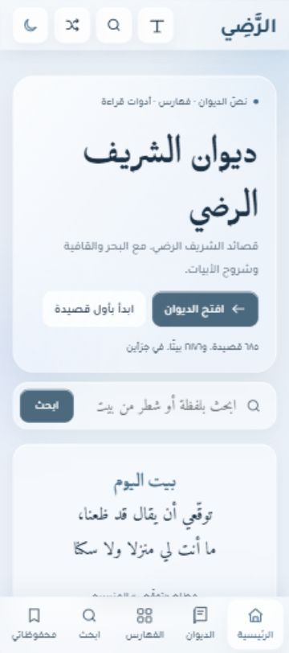
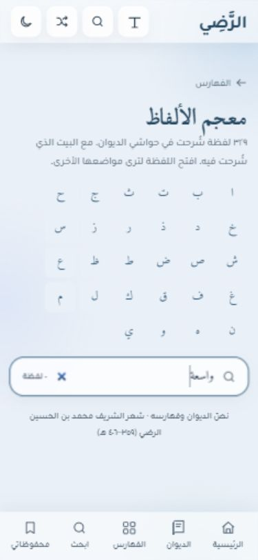
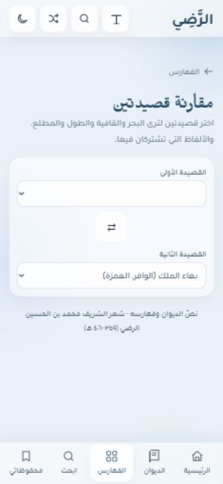
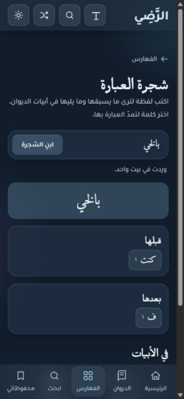

# Diwan UI and UX audit — 24 October 2026

The reading foundation works, but several controls mislead readers or lose their place. The most urgent work is reliable search/tool recovery, keyboard focus, glossary completeness, reading-size behavior, and the home title. Keep the existing glass identity, fonts, routes, and edition text while correcting these behaviors.

## Scope and evidence

- Four independent **GPT-6.1 Sol, medium** reviewers inspected core pages, reading/profiles, indexes, and interactive tools. The lead reviewed their reports and performed the browser pass. One reviewer additionally swept every generated HTML page.
- Current workspace baseline: `e94a2a0`; live browser target: `https://diwan-alradi-ce6.pages.dev/`. No app, edition, original-site, dependency, or deployment changes were made.
- **All 24 page families** were opened and screenshotted at **375 × 812** and **1440 × 900**, in light and dark. Additional states cover search results, saved/empty/removal, verse menus, font settings, the temporary font lab, glossary notes, phrase results/reset, invalid comparison, and wheel navigation. Home was additionally checked at 320 × 667, 810 × 812, and 1024 × 812.
- **All 1,168 generated pages** were inspected structurally: 685 poems, 329 word profiles, 133 place profiles, and 21 standalone pages. This is not a claim that all 1,168 individual pages were manually read in the browser. Visual checks cover every template plus selected content extremes. The longest poem, longest half-line candidate, a split-word verse, a large residual-note block, the longest glossary note, a place with no direct witnesses, and a place with many witnesses were sampled.
- **127 distinct accepted screenshot filenames** are listed in the [screenshot register](ux-2026-10-24-screens.md). A few early captures were replaced after responsive reflow or loading completed. The register points to the final files, not those discarded frames.
- **58 recorded geometry samples**, including repeat/breakpoint samples: no measured document, body, main-content, or heading horizontal overflow. This does not prove every expanded state, every font-lab choice, or all dynamic content is overflow-free.
- Evidence labels: **Observed** = reproduced in this browser run; **Source** = demonstrated by current code/HTML, with browser fault/state reproduction still pending; **Platform risk** = needs the specified real device or assistive technology. Severity is impact in the stated conditions, not a claim about how often those conditions occur.

## Fix first

1. **U14–U17:** recover from failed downloads and invalid URLs; prevent stale results from contradicting the current query/filter.
2. **U02–U07:** make enlargement effective, keep focused controls visible, and preserve keyboard position after menus, loading, or removal.
3. **U01, U09, U22:** keep «الشريف الرضي» together and make expandable/navigation controls explain the action they offer.
4. **U07, U12, U18–U19:** repair incomplete lookup and derived analysis. Rebuild derived metadata only through a documented proposal and owner approval; never alter displayed verse text for this work.

## Consolidated findings

There are **37 consolidated findings**, including source-only and platform-specific items. Repeated findings across reviewers are merged here. The linked source reports retain exact locations, fuller reproduction instructions, and their original evidence limits.

| ID | Priority / evidence | Problem, consequence, and smallest useful correction |
| --- | --- | --- |
| U01 | P2 · Observed | **The home title separates the poet's name.** At 375px it reads «ديوان الشريف» / «الرضي»; at 1024px it becomes three lines, and search falls below the first 812px screen. `index.astro:55` hardcodes the break. Use intentional lines «ديوان» / «الشريف الرضي», size the grouped name against the actual hero column, and reduce excess title height. The desktop welcome title repeats the hero heading and can be removed or shortened. [C07](ux-2026-10-24-core.md#c07--p2-the-home-heading-splits-the-poets-name-by-explicit-markup) |
| U02 | P2 · Observed | **Text-size percentages can increase without enlarging the poem.** On `/poem/r1-227/` at 375px, 120% and 132% both render the first half at approximately **23.50px**. At 100% it is approximately 21.01px. The widest half constrains the entire poem. Explicit enlargement should take priority, with stacking/wrapping when necessary; explain any optional fit mode. [R1](ux-2026-10-24-reading.md) |
| U03 | P2 · Observed | **Auto-hidden navigation keeps invisible keyboard focus.** After scrolling search results, Tab focused «الرئيسية» with its top at **816px in an 812px viewport**; `bars-hidden` remained true. Show bars on focus-within; consider hiding them only during poem reading. [C04](ux-2026-10-24-core.md) |
| U04 | P2 · Observed | **An abandoned verse menu steals arrow keys.** Open verse 1's menu, Tab through its four actions to the home link, then press ArrowDown: focus returns to «نسخ البيت». Restrict menu key handling to focus inside it and dismiss on Tab/focus departure; retain Escape restoration. [R4](ux-2026-10-24-reading.md) |
| U05 | P2 · Observed | **“More results” skips the new results for keyboard users.** Search «الزمان», activate more: the list grows from 40 to 80, focus stays on `#more`, and the next Tab goes to home navigation rather than the first new result. Move focus to the first appended result or provide an explicit, predictable continuation. Source: `search.astro:216–272`. |
| U06 | P2 · Observed | **Saved-item removal loses focus and offers no immediate recovery.** Removing the last audit bookmark leaves `document.activeElement` as BODY. Focus the adjacent card or empty-state action, and offer a short undo if feasible. Initial saving and later listing worked normally. [C05](ux-2026-10-24-core.md) |
| U07 | P2 · Observed | **Meaning search omits later definitions.** The lexicon search «واسعة» returns **٠ لفظة**, although `/word/عين/` visibly contains that meaning as its second article. Search all definitions in a derived search field while retaining the first-meaning preview. [Index 1](ux-2026-10-24-indexes.md) |
| U08 | P3 · Source | **Filtered lexicon letters still point to hidden sections.** After a filter hides a letter group, its alphabet link remains active. Update available letters or hide the alphabet during filtering; clearing restores it. [Index 4](ux-2026-10-24-indexes.md) |
| U09 | P2 · Observed | **Expandable cards look like static statistics.** Meters, rhymes, themes, entities, and relations remove the disclosure marker. In phone and desktop captures, a name/bar/count gives no visual open/closed cue. Keep native details and add one small stateful chevron; do not redesign the cards. [Index 2](ux-2026-10-24-indexes.md), [Tools 8](ux-2026-10-24-tools.md) |
| U10 | P3 · Source | **The filtered catalogue shortcut comes after the entire expanded group.** For الطويل this means 196 poem rows before «عرضها بطاقاتٍ في الديوان». Duplicate the existing shortcut above the list. Preserve static poem links. [Index 3](ux-2026-10-24-indexes.md) |
| U11 | P3 · Source | **Filtered opening groups keep their original counts.** Matali hides nonmatches but leaves each rhyme heading's number unchanged. Recount visible entries or explicitly label the number as the unfiltered total. [Index 5](ux-2026-10-24-indexes.md) |
| U12 | P2 · Source | **Word-frequency metadata was not regenerated from the approved edition.** Current parsed `words` records match legacy source records; current documented token counts do not reproduce several displayed totals. This conflicts with the project's rebuild requirement. Propose a dry-run builder, define conjunction/quote/split-word policy, and obtain approval before changing edition-derived files. Do not infer replacement totals merely from search counts. [Generated finding 1 and diagnostic table](ux-2026-10-24-generated.md) |
| U13 | P3 · Source + observed counts | **Frequency and search use different units without explaining the handoff.** The «الزمان» card lists 300 occurrences / 163 poems; search returns 293 verses / 165 poems. These are different matching/counting concepts, as well as a provenance concern under U12. Explain word occurrences versus matching verses and inclusion inside longer forms. [Index 6](ux-2026-10-24-indexes.md) |
| U14 | P1 under failed network · Source | **Search, phrase, and comparison downloads have no recoverable error state.** Rejected promises remain cached; callers await without handling failure. A failed first request can leave «جارٍ البحث…» / «جارٍ البناء…» / «جارٍ التحميل…» with no working retry. Check HTTP success, catch at boundaries, reset failed promises, preserve input, and show an Arabic retry action. Network fault injection was not performed in this run. [C01](ux-2026-10-24-core.md), [Tools 1](ux-2026-10-24-tools.md) |
| U15 | P2 · Source | **Clearing a search does not invalidate a pending run.** The empty-query return precedes `++runId`; a delayed earlier result can repopulate an erased search. Invalidate every run before branching, and cancel queued typing work on explicit submit. [C02](ux-2026-10-24-core.md) |
| U16 | P2 · Source | **Old results stay actionable during a new search and can use the wrong presentation.** During the first notes download, More reads the live field but still iterates old matches. Disable/mark stale results during loading and keep completed-query metadata with its matches. [C03](ux-2026-10-24-core.md) |
| U17 | P2 · Observed | **An invalid comparison URL produces an empty selector and no error explanation.** `/research/compare/?a=missing&b=r1-002` becomes `?a=&b=r1-002` and throws `TypeError: Cannot read properties of undefined (reading 'text')`. Validate IDs and empty verse sets; recover to valid defaults or a clear selection prompt. [Tools 2](ux-2026-10-24-tools.md) |
| U18 | P2 · Observed | **A split word becomes a false standalone token in linguistic tools.** For r1-008 v4, the edition marks «بالخيـ # ف» as one split word. Phrase query «بالخي» returns that verse and offers **«ف»** as the next word. Join the marked boundary only in derived analysis and retain an offset mapping to untouched displayed halves. [Tools 3](ux-2026-10-24-tools.md) |
| U19 | P2 · Observed + Source | **The phrase tree hides most continuations and examples without saying so.** «الدهر» reports 269 verses, but only 14 alternatives per side and 30 examples can be reached. Add visible/total labels and incremental expansion; the compact initial state is useful. [Tools 4](ux-2026-10-24-tools.md) |
| U20 | P2 · Source | **Phrase expansion removes its own focused button.** Rebuilding replaces all branch controls without focus restoration. Restore a deliberate stable/replacement target and announce the new phrase/result state. Exact screen-reader behavior is untested. [Tools 5](ux-2026-10-24-tools.md) |
| U21 | P3 · Observed | **Clearing the phrase leaves the old tree and shared URL.** Build «الدهر», empty the input, submit: the old count, tree, samples, and `?q=` remain. Clear those states on an empty query, including native search-clear handling. [Tools 6](ux-2026-10-24-tools.md) |
| U22 | P3 · Observed | **A wheel selection does not show the promised poems.** Choosing ب lands at `/explore/qafiya/#الباء` with its 87-poem group still collapsed. Open the targeted disclosure on arrival/hash change, or use the existing filtered catalogue URL. [Tools 7](ux-2026-10-24-tools.md) |
| U23 | P2 · Source | **Failed storage writes announce success.** Save/removal catches persistence errors silently, toasts success, then rereads unchanged storage. Return a write result and explain failure; distinguish any session-only fallback. Applies to reader and saved list. Quota/denial was not injected. [C06](ux-2026-10-24-core.md), [R2](ux-2026-10-24-reading.md) |
| U24 | P2 · Source | **Wrong-shape saved JSON can disable unrelated reader controls.** Valid JSON such as `{}` or `null` passes parsing, then `.some()` throws before later listeners register. Validate stored arrays/items and reading preference values, with safe defaults. Do not require a user to clear all browser data. [R3](ux-2026-10-24-reading.md) |
| U25 | P3 · Source | **Layout choices advertise radio behavior without the expected arrow navigation.** Three role=radio buttons are separate Tab stops and only clicks change state. Use native radios or implement the complete group keyboard model. [R5](ux-2026-10-24-reading.md) |
| U26 | P3 · Source | **Active filter restrictions have no convenient reset.** The catalogue reset appears only at zero results; collapsed options give a count rather than the actual restrictions. Show a short active-filter summary and clear-restrictions action while keeping the query. [C09](ux-2026-10-24-core.md) |
| U27 | P3 · Observed + Source | **Long reference lists have inconsistent orientation aids.** Matali has 685 openings without a rhyme jump row; words has 240 entries without a local filter; entities puts places after people without section links. The mobile lexicon spends five letter rows before its search input. Reuse existing jump/filter patterns and move lexicon search above the alphabet. Long content itself is expected in a diwan; the issue is targeted navigation. [Index 7](ux-2026-10-24-indexes.md) |
| U28 | P3 · Source | **Related-word chip numbers lack a unit.** Readers cannot tell whether a chip counts occurrences, verses, or shared poems. Explain «عدد القصائد المشتركة» once and include the unit in accessible names where helpful. [Tools 8](ux-2026-10-24-tools.md) |
| U29 | P2 · Observed | **Map labels shrink below comfortable phone reading size.** The 900-unit SVG's 15-unit labels shrink to roughly 5–6px at normal phone scale; dense areas cannot be read comfortably. The complete place list is a useful fallback. Offer a larger map view/zoom and a clear route to the list. Overlapping invisible hit circles are a separate unconfirmed risk; this audit does not claim a reproduced wrong-place tap. Source: `AtlasMap.astro:133,152–156`. |
| U30 | P3 · Observed | **Rare rhyme sectors are impractically narrow for precise phone selection.** The linked legend provides the working alternative. Make that alternative prominent and ensure rare letters remain easy to choose; do not force every wheel slice into an oversized sector or add a chart library. [Tools conditional risk 5](ux-2026-10-24-tools.md) |
| U31 | P3 · Observed | **Saved removal has a smaller tap area than adjacent primary controls.** Its measured box is approximately **72.4 × 34.4px**. Raise the minimum height to the site's 44px touch convention. This measurement alone is not a claim of a WCAG target-size failure. Source: `saved.astro:119–122`. |
| U32 | P3 · Platform risk | **Catalogue input is 15px on phones.** This may trigger focus zoom on iPhone Safari. Use 16px or more and verify keyboard/fixed-navigation behavior on a real iPhone. Desktop emulation does not establish the iOS outcome. [C08](ux-2026-10-24-core.md) |
| U33 | P3 · Source | **The theme button's accessible label never updates.** It still says night-mode toggle in both states and has no pressed state. Expose a stable toggle state or label the next action. Both visual themes themselves worked in this pass. [C10](ux-2026-10-24-core.md) |
| U34 | P3 · Source | **Catalogue filters look usable when their script is unavailable.** Without JS, a filtered URL still shows the full list with no explanation. Add a concise no-JS/full-list notice and disable unavailable controls. Static poem links should remain usable. [C11](ux-2026-10-24-core.md) |
| U35 | P3 · Observed | **Glossary citations put a middle dot beside page digits.** Expanded القعاقع shows `ص ١٤ · الصفحة في النسخة الرقمية`. Replace that UI separator with «،», following the project's rule; leave the note and page number unchanged. [R6](ux-2026-10-24-reading.md) |
| U36 | P3 · Source | **Biography dates change numeral style.** Authored prose uses `359هـ` / `406هـ` while the lead uses Arabic-Indic digits. Make authored UI prose consistent without changing edition data. [R7](ux-2026-10-24-reading.md) |
| U37 | P3 · Observed + Source | **Residual footnotes are only discoverable after the entire poem.** The r2-156 fixture has a folded 51-note block after 89 verses; the header reports linked explanations but offers no direct route/count for this residual block. Add a header link with its separate count. Do not guess verse associations or rewrite repeated source note numbering. Source: `poem/[id].astro:79–83,189–202`. |

## Key visual evidence

### 1. Home at phone width — needs correction (U01)

The name is deliberately broken between الشريف and الرضي. Search is still reachable on the first screen at this 375px size; at 1024px the three-line title pushes it below the first screen.

[1024px three-line title](../output/playwright/ux-2026-10-24/home-1024-dark.jpg) · [320px phone](../output/playwright/ux-2026-10-24/home-320-dark.jpg)

### 2. Lexicon lookup — incomplete (U07)

Searching for واسعة returns zero. The second definition on عين proves that this is an incomplete search, not an absent glossary meaning.

[Word profile with both definitions](../output/playwright/ux-2026-10-24/25-word-mobile-light.jpg)

### 3. Comparison invalid URL — broken recovery (U17)

The blank first selector has no explanation; the captured console error is in [browser-console.json](../output/playwright/ux-2026-10-24/browser-console.json). Normal comparison did load for valid selections.

### 4. Derived split-word analysis — incorrect (U18)

The tree treats ف as the word after بالخي, although this is one word divided across the edition's two halves. The poem display itself was left untouched.

### 5. Reading size and keyboard focus — need correction (U02–U06)

[120%](../output/playwright/ux-2026-10-24/reader-stable-120.jpg) and [132%](../output/playwright/ux-2026-10-24/reader-stable-132.jpg) have the same approximately 23.50px fitted size in this fixture. [Verse-menu focus recapture](../output/playwright/ux-2026-10-24/reader-menu-focus-recapture.jpg) accompanies the reproduced Tab → home → ArrowDown → copy sequence. [Saved removal](../output/playwright/ux-2026-10-24/saved-remove-focus-lost.jpg) leaves BODY focused. Native sharing, clipboard permission variants, and screen-reader speech were not exhaustively tested.

## Page-by-page coverage and general health

Every row below has phone light/dark and desktop light/dark screenshots in the [register](ux-2026-10-24-screens.md). “Usable” describes the observed normal state, not a guarantee that all conditional findings are absent. Global shell findings apply across routes.

| Step | Page / route family | General health and specific follow-up |
| ---: | --- | --- |
| 1 | Home `/` | Usable entry points; title/name and desktop height need correction, U01. |
| 2 | Catalogue `/diwan/` | Usable normal list/filter disclosure; improve reset and real-iPhone input, U26/U32/U34. |
| 3 | Search `/search/` | Normal query/highlighting loaded; error/race/focus issues, U03/U05/U14–U16/U26. |
| 4 | Saved `/saved/` | Empty, saving, listing, and removal observed; focus/tap/storage issues, U06/U23/U24/U31. |
| 5 | Explore `/explore/` | Descriptive links work; usable single-column phone hub; many equally weighted choices are an optional future grouping opportunity, not a broken interaction. |
| 6 | Meters `/explore/meters/` | Usable native groups; expansion and shortcut discoverability, U09/U10. |
| 7 | Qafiya `/explore/qafiya/` | Alphabet links work; group/action cue and closed arrival, U09/U10/U22. |
| 8 | Openings `/explore/matali/` | Usable normal cards; filtered count and rhyme orientation, U11/U27. |
| 9 | Themes `/explore/themes/` | Classification caveat is clear; disclosure cue needs work, U09. |
| 10 | Entities `/explore/entities/` | Match caveat is clear; disclosure and people/place navigation, U09/U27. |
| 11 | Statistics `/explore/stats/` | Usable and no measured overflow; actual screen-reader chart narration remains untested. |
| 12 | Lexicon `/explore/lexicon/` | Incomplete meaning filter; alphabet/filter consistency and search placement, U07/U08/U27. |
| 13 | Frequency `/explore/words/` | Cards render; provenance, counting units, and targeting need work, U12/U13/U27. |
| 14 | Hijaz `/explore/hijaz/` | Usable cards and place links; selection method is explained; no new route-specific blocker established. |
| 15 | Atlas `/explore/atlas/` | List fallback works; phone map labels need larger access, U29. Dense-cluster wrong-place taps unconfirmed. |
| 16 | Wheel `/explore/rhymes/` | Legend works; narrow sectors and collapsed destination, U22/U30. |
| 17 | Relations `/explore/relations/` | Static disclosure structure works; action cues and count units, U09/U28. |
| 18 | Phrases `/explore/phrases/` | Populated tree works; derived words, limits, reset, focus and failure recovery, U14/U18–U21. |
| 19 | Compare `/research/compare/` | Valid pair loads; invalid link recovery and load failure, U14/U17. All-685 native pickers merit real-phone testing before replacing them. |
| 20 | About `/about/` | Readable biography/section links; numeral consistency, U36. |
| 21 | Unknown URL / `404.html` | Meaningful recovery screen; actual unknown-route HTTP 404 confirmed. |
| 22 | All 685 poem pages `/poem/<id>/` | All structurally checked; browser reading fixtures usable; enlargement/menu/layout/notes issues, U02/U04/U23–U25/U37. |
| 23 | All 329 word profiles `/word/<term>/` | All glossary articles retain verse destinations; sampled multi-meaning/long-note profiles usable; citation U35. |
| 24 | All 133 place profiles `/place/<name>/` | All witness links resolve; sampled long-note/no-direct-witness/many-witness states make their limits clear; map issue U29. |

## Verification and boundaries

- `SITE_URL=https://diwan-alradi-ce6.pages.dev NOINDEX=1 npm run build`: **passed**, 1,168 pages.
- `npm run verify`: **passed**, 35,706 internal links and 32,342 verse halves checked, 1,166 sitemap URLs. All edition text checks passed.
- `npm run check`: **0 errors / 0 warnings, 4 hints** (unused imports/variable and the existing clipboard fallback's deprecated signature).
- `npm test`: **passed**, Arabic matching tests.
- Extra structural sweep: **81,165 local href references**, **47,473 fragments**, **zero missing destinations**, **zero duplicate IDs**, no zero-verse poem or empty rendered half. These counts include sprites/assets and therefore differ from `verify`'s link count. [Full method and inventory](ux-2026-10-24-generated.md).
- Live HTTP: home **200**, unknown route **404**, verse URL **301 → /poem/r1-227/#v3**, old openings **301 → matali**, old observatory **301 → stats**, Arabic relation **301 → relations hash**. [Responses](../output/playwright/ux-2026-10-24/http.json).
- Console: invalid comparison produced the error documented in U17; do not report “zero console errors.” No full network fault injection, invalid-storage injection, real iOS keyboard/picker run, screen-reader speech audit, all-font matrix, or formal contrast/WCAG certification was completed.
- Geometry and screenshots are current-run evidence, with [raw measurements](../output/playwright/ux-2026-10-24/geometry.json) and [URL manifest](../output/playwright/ux-2026-10-24/screenshots.json). The map/wheel are intentionally visual; their text alternatives reduce severity but do not make tiny labels comfortable.
- No claim that every possible UX defect has been found. No claim that all individual generated pages received manual visual inspection. The full generated corpus was structurally checked; every distinct page template and selected content/interaction extremes received visual review.
- The preview's `NOINDEX=1` and temporary font lab are intentional owner decisions and were **not** treated as defects. No redesign, editorial correction, or deployment is part of this audit.

## Source-review appendices

1. [Core pages and shell](ux-2026-10-24-core.md)
2. [Reading, profiles, biography, and font lab](ux-2026-10-24-reading.md)
3. [Reference indexes](ux-2026-10-24-indexes.md)
4. [Interactive tools](ux-2026-10-24-tools.md)
5. [Every generated page: structure and metadata provenance](ux-2026-10-24-generated.md)

These appendices are independent source reviews. Their “browser pending” notes describe each worker's evidence boundary; the consolidated findings above explicitly identify what the lead subsequently reproduced.
